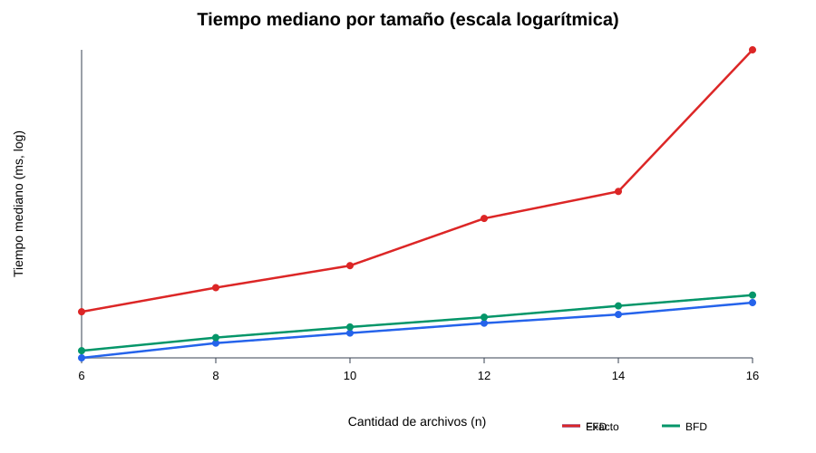

# Avance 7 - Experimentos preliminares y preparación de la segunda entrega

**Proyecto:** Bin Packing 1D aplicado a backups  
**Equipo:** Grupo 3 - Algoritmos Avanzados, UNSAAC, semestre 2026-2  
**Fecha:** 6 de noviembre de 2026  
**Base revisada:** `entrega1`, estado del proyecto, informe de Entrega 1, avances 4-5, código, instancias JSON, pruebas y resultados existentes.

## 1. Identificación y alcance

El sistema asigna archivos de tamaños positivos a discos de capacidad uniforme para minimizar la cantidad de discos. La versión revisada integra tres alternativas: First Fit Decreasing (FFD) y Best Fit Decreasing (BFD), ambas heurísticas, y Branch and Bound, que busca el óptimo en instancias pequeñas. El informe de Entrega 1 plantea el problema y el plan experimental; `docs/AVANCES_4_5.md` registra la implementación e integración previas. La carpeta `results/experiments` no contenía resultados al iniciar este avance.

## 2. Flujo integrado verificado

1. **Entrada:** JSON (`capacity` y `files`), lista dada por CLI o instancia sintética.
2. **Validación:** capacidad y tamaños finitos y positivos; ningún archivo puede superar la capacidad.
3. **Ejecución:** FFD, BFD, exacto o los tres con `--algorithm compare`.
4. **Verificación:** cada archivo aparece exactamente una vez y ninguna carga excede la capacidad.
5. **Métricas:** número de discos, tiempo medido con `perf_counter`, desperdicio total, utilización y brecha frente al óptimo cuando se ejecuta el exacto.
6. **Resultados:** impresión en consola; este avance agrega CSV y gráfico SVG reproducibles.

## 3. Diseño experimental y reproducibilidad

Se generaron instancias con capacidad 100, tamaños enteros en el intervalo definido por el generador (10 a 50), tamaños `n = 6, 8, 10, 12, 14, 16` y semillas 42, 43 y 44. Se corrieron los tres algoritmos sobre cada instancia. Para cada algoritmo e instancia se tomaron cinco mediciones de tiempo y se guardó la mediana; por tanto, hay 18 instancias y 270 ejecuciones medidas. Las salidas se verificaron con `validate_solution`.

Artefactos:

- `results/experiments/resultados_avance7.csv`: 54 filas (18 instancias por 3 algoritmos), valores por instancia, semilla, tiempos, utilización, validez y brecha.
- `results/experiments/tiempos_avance7.svg`: tiempos medianos agregados por tamaño en escala logarítmica.
- `src/experiments.py`: generador y procedimiento de medición.

Para repetir desde la raíz de `entrega1`:

```powershell
python -m unittest discover -s tests -v
python src\main.py --instance data\instances\instancia_pequena.json --algorithm compare
python src\main.py --instance data\instances\instancia_adversa.json --algorithm compare
python src\experiments.py
```

El último comando sobrescribe únicamente los dos archivos de resultados experimentales indicados. El generador usa semillas explícitas; los tiempos pueden cambiar con el hardware, el intérprete y la carga del equipo.

## 4. Resultados observados

Resumen de medianas de tiempo por tamaño, tomando la mediana entre las tres semillas (milisegundos):

| n | FFD (ms) | BFD (ms) | Branch and Bound (ms) | Brecha media FFD | Brecha media BFD |
|---:|---:|---:|---:|---:|---:|
| 6  | 0.0077 | 0.0081 | 0.0176 | 0.333 | 0.333 |
| 8  | 0.0096 | 0.0104 | 0.0248 | 0 | 0 |
| 10 | 0.0117 | 0.0132 | 0.0393 | 0 | 0 |
| 12 | 0.0142 | 0.0159 | 0.0919 | 0 | 0 |
| 14 | 0.0168 | 0.0193 | 0.1931 | 0 | 0 |
| 16 | 0.0204 | 0.0227 | 1.7262 | 0 | 0 |

La brecha es la cantidad de discos de la heurística menos la cantidad de Branch and Bound; cero indica que igualó el óptimo comprobado. En los 18 casos sintéticos, FFD y BFD igualaron el óptimo en 17; en la instancia de seis archivos con semilla 44, cada heurística usó tres discos y el exacto dos. Las heurísticas son más rápidas en este rango. FFD fue ligeramente más rápida que BFD en las medianas agregadas; la diferencia absoluta es de microsegundos y no debe generalizarse.

En la instancia JSON pequeña `[6, 6, 4, 4]`, las tres alternativas usaron dos discos, con utilización del 100 %. En la instancia marcada adversa `[6, 6, 6, 4, 4, 4]`, las tres usaron tres discos, también con 100 % de utilización. Ambos casos pasaron la verificación. Estas instancias son demostraciones pequeñas, no evidencia de superioridad general.



## 5. Interpretación y complejidad

FFD y BFD ordenan los archivos y luego recorren discos candidatos. En la implementación actual su costo se expresa como `O(n log n + nB)`, donde `B` es el número de discos abiertos; en el peor caso `B <= n`, lo que da cota `O(n²)`. BFD además crea una lista de candidatos para cada archivo, por lo que el costo observado es similar, con una constante algo mayor en estas corridas. La complejidad depende de la implementación; estructuras especializadas podrían reducir el costo de búsqueda.

Branch and Bound usa FFD como cota inicial, explora asignaciones y poda estados, pero mantiene costo exponencial en el peor caso. En la muestra pequeña su tiempo creció más rápido y se separó con claridad en `n=16`; no es válido extrapolar tiempos medidos hasta tamaños grandes. Durante un barrido exploratorio que intentaba llegar a 28 archivos, la ejecución no terminó dentro de la ventana de trabajo y no produjo un conjunto completo; por rigor no se incluyen esos datos. El máximo configurado de 28 elementos es un límite de entrada, no una garantía de tiempo de respuesta.

Las mediciones inferiores a unas pocas centésimas de milisegundo son muy sensibles a resolución del reloj, calentamiento, cachés y carga del sistema. Sirven como comprobación inicial del orden relativo en este equipo, no como benchmark controlado. El tamaño de salida/calidad es la comparación más útil para la muestra.

## 6. Validación y pruebas

Se ejecutó `python -m unittest discover -s tests -v`: **10 pruebas aprobadas**. Cubren casos básicos, vacío y archivo igual a capacidad, caso adverso con referencia manual, instancia desbalanceada, entradas inválidas, límite del algoritmo exacto, reproducibilidad del generador y los caminos CLI de comparación, generación y carga JSON.

También se ejecutó `compare` sobre ambos JSON de `data/instances`. FFD, BFD y Branch and Bound reportaron `Validacion: OK`, 2 discos para la instancia pequeña y 3 para la marcada adversa. La instancia manual `[4, 3, 2.5, 2, 1.5, 1]`, capacidad 5, ya figura como caso integrado en la suite.

## 7. Documentación, correcciones y estado para segunda entrega

La documentación técnica en `README.md` se actualiza con arquitectura, requisitos, parámetros, formatos, ejecución y reproducción experimental. La bitácora independiente se entrega en `docs/BITACORA_AVANCE_7.md`.

Correcciones ya registradas en los avances anteriores: se aclaró que el algoritmo exacto es Branch and Bound (no programación dinámica); se integraron validación común, carga/generación y ejecución de alternativas; se añadieron comprobaciones de solución y límite para el exacto. Este avance agrega evidencia experimental reproducible y deja explícito que las instancias medidas no justifican conclusiones amplias.

| Evidencia para segunda entrega | Estado observado |
|---|---|
| Implementación funcional e integración | Disponible en `src/` y verificada por CLI |
| Pruebas automatizadas | 10/10 aprobadas en esta ejecución |
| Complejidad teórica | Descrita en `README.md` y este informe; exacto exponencial |
| Experimentos preliminares | 18 instancias, 3 algoritmos, 5 repeticiones; CSV y SVG incluidos |
| Documentación técnica | README actualizado y presente informe |
| Bitácora, dificultades y pendientes | `docs/BITACORA_AVANCE_7.md` |
| Repositorio y trazabilidad | Historial previo presente; debe incorporarse y revisar el nuevo conjunto de archivos |
| Validación en almacenamiento/AWS | Pendiente según estado del proyecto; no se ejecutó en este avance |

## 8. Pendientes recomendados

- Ampliar semillas y distribuciones (uniforme, concentrada y cercana a la capacidad) y documentar los parámetros.
- Medir rangos mayores para FFD/BFD por separado del exacto; ejecutar el exacto con límite de tiempo y registrar instancias que excedan ese límite.
- Repetir tiempos en un entorno controlado y con más repeticiones para reducir ruido.
- Añadir casos que comparen explícitamente brechas entre heurísticas y óptimo.
- Confirmar instalación limpia en un entorno virtual y registrar versiones de Python/SO junto a cada ejecución.
- Resolver asuntos de integración pendientes y prueba real en AWS indicados en `ESTADO_PROYECTO.md` antes de la entrega final.

## 9. Alcance de lo ejecutado

Se inspeccionaron `ESTADO_PROYECTO.md`, `Informe_Entrega_1.md`, `README.md`, `docs/AVANCES_4_5.md`, fuentes de `src/`, instancias JSON, pruebas, requisitos e historial Git. No se modificaron los algoritmos de empaquetamiento. Se añadieron el ejecutor de experimentos, sus resultados, este informe, la bitácora y las instrucciones técnicas actualizadas. Los tiempos corresponden a esta máquina y no representan una evaluación de AWS ni de discos físicos.

## 10. Ampliación posterior para cerrar la segunda entrega (18 de noviembre de 2026)

Se añadió `src/experiments_extended.py` con tres distribuciones (uniforme 10–90, concentrada 40–60 y cercana a capacidad 70–95), cuatro tamaños (6, 10, 14 y 18) y tres semillas (42–44). Son 36 instancias y 108 filas en `results/experiments/resultados_ampliados.csv`. Cada fila guarda la instancia, el número de discos, la mediana de hasta tres tiempos, la brecha frente al exacto cuando está disponible, el estado, la versión de Python y el sistema operativo. Las 108 corridas terminaron sin exceder el límite de 0.5 segundos en el entorno de esta ejecución. Las dos heurísticas coincidieron con el exacto en todas estas instancias; esta muestra no permite concluir equivalencia general.

Branch and Bound admite ahora `timeout_s`, y el CLI expone `--exact-timeout` (5 segundos por defecto). Si se agota, la salida indica la omisión del exacto, sin publicar una brecha no verificada. Se agregó una prueba para el vencimiento y para el parámetro inválido. La suite actual tiene 11 pruebas.

Para reproducir la ampliación desde la raíz: `python -B src/experiments_extended.py`. Las versiones del entorno quedan en el CSV. La validación física/AWS continúa pendiente porque requiere infraestructura y credenciales del equipo; no forma parte de la evidencia experimental aquí registrada.
